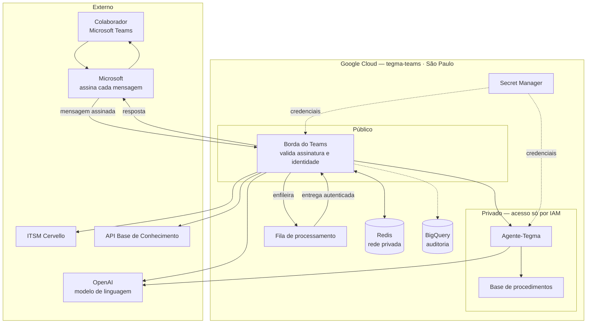
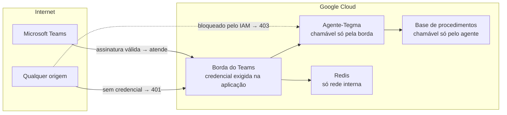

# Arquitetura e Topologia

## Componentes

| Componente | Papel | Exposição |
|---|---|---|
| **Borda do Teams** (`tegma-bot-service`) | Recebe as mensagens, valida assinatura e identidade, decide o caminho e executa as ações (abrir e consultar chamado) | **Pública**, porque o Teams precisa alcançá-la. Toda rota exige credencial |
| **Agente-Tegma** | Redige a conversa e consulta a base de procedimentos | Privado: só a borda pode chamá-lo |
| **Base de procedimentos** | Busca nos procedimentos internos da Tegma | Privada: só o Agente-Tegma pode chamá-la |
| **Fila de processamento** (Cloud Tasks) | Entrega cada mensagem para processamento, com novas tentativas | Interna do Google Cloud |
| **Redis** | Estado da conversa, controle de duplicidade e limites de uso | Rede privada (VPC), com senha |
| **BigQuery** | Telemetria e auditoria | Acesso por IAM nominal |
| **Secret Manager** | Cofre de credenciais | Acesso nominal por serviço |

## Diagrama

!!! note "Princípio central"
    A IA **conversa**, mas não **age**. Abrir chamado, consultar chamado e enviar avisos são
    executados por código determinístico na borda, com a identidade vinda do Teams e com
    confirmação escrita. O Agente-Tegma só tem acesso de leitura à base de procedimentos.

## Rede e acesso

| Controle | Efeito |
|---|---|
| Uma conta de serviço por componente | Cada serviço só alcança o que precisa. Nenhuma conta tem papel amplo de projeto |
| Serviços internos privados | Requisição sem identidade autorizada é recusada pelo Google (403) antes de chegar ao código |
| Redis sem exposição | Porta acessível só pela rede interna, com senha obrigatória |
| Acesso administrativo | SSH e RDP padrão desabilitados. Acesso a máquina só via Identity-Aware Proxy (autenticação Google) |
