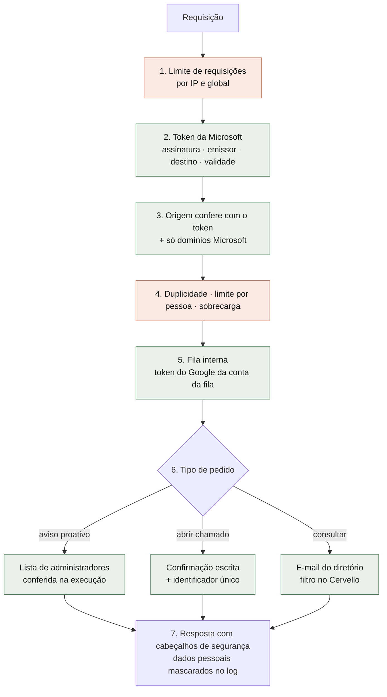

# Camadas de Segurança

A defesa é em camadas, na **ordem real de execução**. Cada camada tem um comportamento definido
para quando uma dependência falha:

- **Autenticação e autorização falham fechadas:** na dúvida, recusam.
- **Controles de disponibilidade falham abertos:** na dúvida, atendem e alertam.

<small>Verde: falha fechada (recusa). Terracota: falha aberta (atende e emite alerta).</small>

## Camadas em detalhe

| # | Camada | Controle |
|---|---|---|
| 1 | **Borda** | Teto de requisições por IP e global, contado **antes** da autenticação. O IP considerado é o real, informado pela infraestrutura do Google, e não pode ser forjado pelo cliente |
| 2 | **Autenticação** | Token RS256 da Microsoft, com chaves públicas oficiais, emissor, destino e validade. As recusas são idênticas e não dão pistas |
| 3 | **Origem** | O endereço de resposta tem de bater com o do token e pertencer à Microsoft, o que evita SSRF |
| 4 | **Abuso** | Mensagem repetida descartada, 15 mensagens por minuto por pessoa, teto de fila |
| 5 | **Rota interna** | Aceita só token do Google emitido para a conta da fila |
| 6 | **Autorização** | Ações administrativas conferidas na execução. Ações com efeito externo exigem confirmação escrita |
| 7 | **Saída e logs** | Cabeçalhos de segurança (CSP restritiva, HSTS, anti-framing, nosniff). E-mails mascarados e dados pessoais filtrados no log |
| 8 | **Rede e IAM** | Serviços internos privados, uma conta de serviço por componente, sem papéis amplos de projeto |
| 9 | **Segredos** | Secret Manager. Leitura de segredos registrada em log de auditoria |

## Cadeia de suprimentos

| Controle | Detalhe |
|---|---|
| **Dependências** | Toda versão passa por varredura de vulnerabilidades conhecidas (`pip-audit`), que **bloqueia** o deploy. Riscos aceitos são registrados um a um, com justificativa |
| **Imagens de contêiner** | Varredura com Trivy a cada build. Vulnerabilidade crítica fora da lista de risco aceito bloqueia a publicação |
| **Contêineres** | Executam sem privilégio de root, com imagem mínima e sem ferramentas de compilação |
| **Componentes de terceiros** | Versões fixas (nunca `latest`). Vulnerabilidades sem correção publicada e fora do caminho de execução ficam registradas como risco aceito |

## Validação independente

| Validação | Resultado |
|---|---|
| **Pentest externo** (black-box, 09/09/2026) | Nenhum achado crítico, alto ou médio. Um achado baixo, corrigido. As recomendações de endurecimento também foram aplicadas |
| **Verificador de postura** (somente leitura) | Dezenas de checagens no ambiente real: contas públicas, privilégio mínimo, firewall, auditoria de segredos, recusas de toda a superfície, cabeçalhos. **Pode ser executado pela equipe da Tegma** |
| **Teste da superfície** | A cada build, todas as rotas exigem credencial |
| **Bateria da IA** | A cada versão do agente: escopo, jailbreak, exfiltração e procedimento interno |
