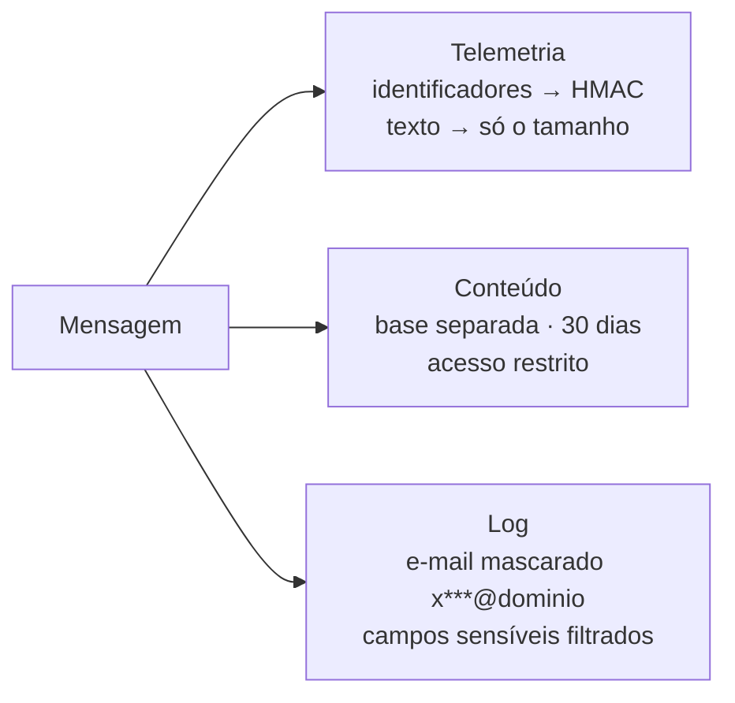

# Dados, Privacidade e Auditoria

## Onde ficam os dados

| Dado | Onde | Retenção | Acesso |
|---|---|---|---|
| **Telemetria** (volume, tempos, desfechos) | BigQuery `auditoria` | 5 anos | IAM nominal |
| **Conteúdo das conversas** (pergunta e resposta) | BigQuery `conversas`, separado | **30 dias** | Restrito ao time de dados |
| **Estado da conversa** | Redis (rede privada) | 7 dias | Só a aplicação |
| **Prints em trânsito** | Redis, fora do estado da conversa | **15 minutos** | Só a aplicação |
| **Logs da plataforma** | Cloud Logging | 30 dias | IAM nominal |
| **Chamados** | Cervello | Política da Tegma | Sistema da Tegma |

Tudo é processado no Google Cloud, região **São Paulo**. A exceção é o texto enviado ao modelo
de linguagem (OpenAI).

## Proteção de dados pessoais

| Controle | Detalhe |
|---|---|
| **Pseudonimização** | Identificadores do Teams viram hash HMAC-SHA256, com chave própria do ambiente guardada no cofre. Não dá para reverter sem a chave |
| **Telemetria sem conteúdo** | Um teste automatizado impede que qualquer evento de telemetria carregue texto |
| **E-mail** | Nunca gravado inteiro. No log aparece mascarado |
| **Respostas da triagem e prints** | Vão só para o chamado, nunca para telemetria ou log |
| **Retenção assimétrica** | Dados pseudonimizados por mais tempo, para medir o serviço. Conteúdo pessoal por pouco tempo |
| **Verificação** | Uma varredura de eventos reais encontrou zero e-mail, CPF, telefone, senha ou cartão na telemetria |

## Rastreabilidade

- Cada mensagem tem um **identificador de rastreio**, que liga os eventos do início ao fim sem expor a pessoa.
- Recusas de acesso (`acesso_negado`) e ações negadas por falta de permissão ficam registradas.
- Cada chamado aberto registra **como foi confirmado**: por texto ou por botão.
- Toda leitura de segredo fica no log de auditoria do Google Cloud.

## Alertas de segurança e operação

| Alerta | Dispara quando |
|---|---|
| Sondagem da fronteira | Mais de 30 credenciais recusadas em 10 minutos |
| Usuários sendo recusados | Recusas por limite ou sobrecarga acima do normal |
| Atendimento falhando ou lento | Respostas não entregues, ou demora acima da meta |
| Abertura de chamado falhando | Erros repetidos na criação de chamados |
| Fila em contingência | A fila interna deixa de ser usada |

Os alertas, métricas e painéis são mantidos como código no repositório. Um verificador acusa
qualquer diferença entre o que está configurado e o que deveria estar.

## Decisões de privacidade a cargo da Tegma

!!! warning "Para o Jurídico/DPO da Tegma"
    - **Base legal e aviso aos usuários.** O sistema já permite exibir um aviso de privacidade na mensagem de boas-vindas.
    - **Dados sensíveis digitados espontaneamente** (CPF, matrícula, saúde). Não há remoção automática.
    - **Prazos de retenção:** confirmar 5 anos para a telemetria e 30 dias para o conteúdo.
    - **Processamento do texto pela OpenAI, fora do Brasil.**
