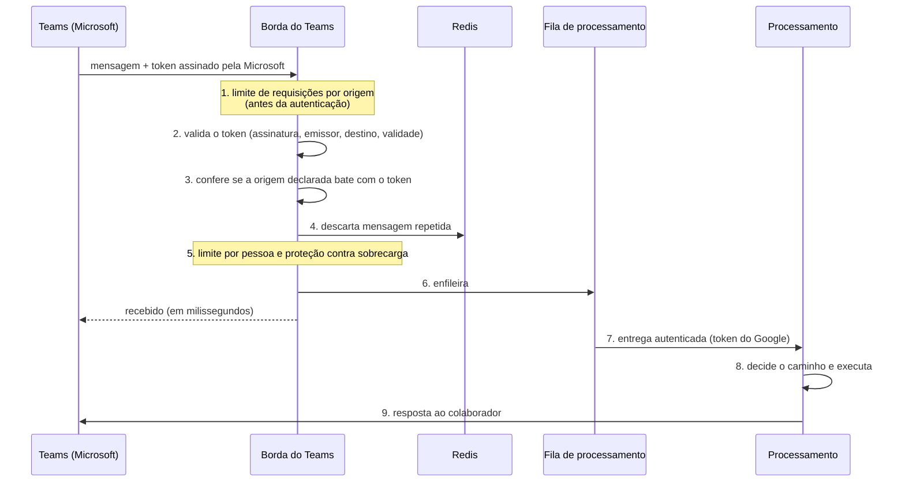

# Fluxo de uma Mensagem

Toda mensagem passa pelos mesmos controles, na mesma ordem, antes de qualquer processamento.

## Etapas e controles

| # | Etapa | Controle de segurança | Se falhar |
|---|---|---|---|
| 1 | Limite por origem | Teto de requisições por IP e global, contado **antes** da autenticação | Recusa com 429 |
| 2 | Autenticação | Token RS256 assinado pela Microsoft, com emissor, destino e validade conferidos | **401**, com a mesma resposta para qualquer motivo |
| 3 | Origem | O endereço de resposta declarado tem de bater com o do token e pertencer à Microsoft (anti-SSRF) | **401** |
| 4 | Duplicidade | Cada mensagem é processada uma única vez | Ignora a repetição |
| 5 | Abuso | 15 mensagens por minuto por pessoa e teto de fila | Aviso à pessoa |
| 6–7 | Fila | A entrega interna exige token do Google emitido para a conta da fila | **401** |
| 8 | Decisão | Pedidos óbvios ("abrir chamado", "meus chamados", "cancelar") são resolvidos **sem IA**. O resto vai ao Agente-Tegma | — |
| 9 | Resposta | Enviada só a endereços da Microsoft. Em grupo, só responde quando o assistente é @mencionado | — |

!!! note "Responder rápido não reduz a segurança"
    O Teams exige confirmação em poucos segundos. Por isso a borda confirma o recebimento e
    entrega o processamento a uma fila. A rota interna que recebe da fila é tão protegida quanto a
    pública: ela só aceita chamadas assinadas pelo Google para a conta da fila.
