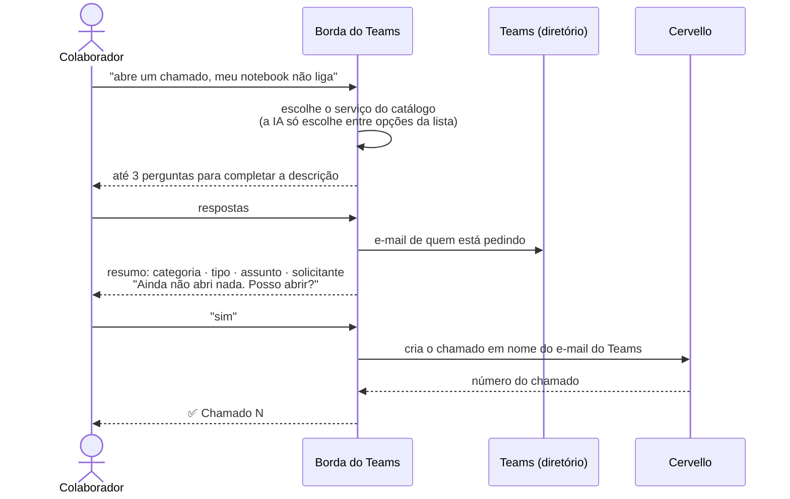
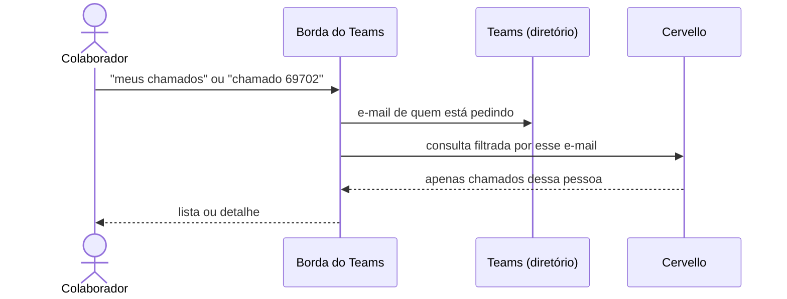
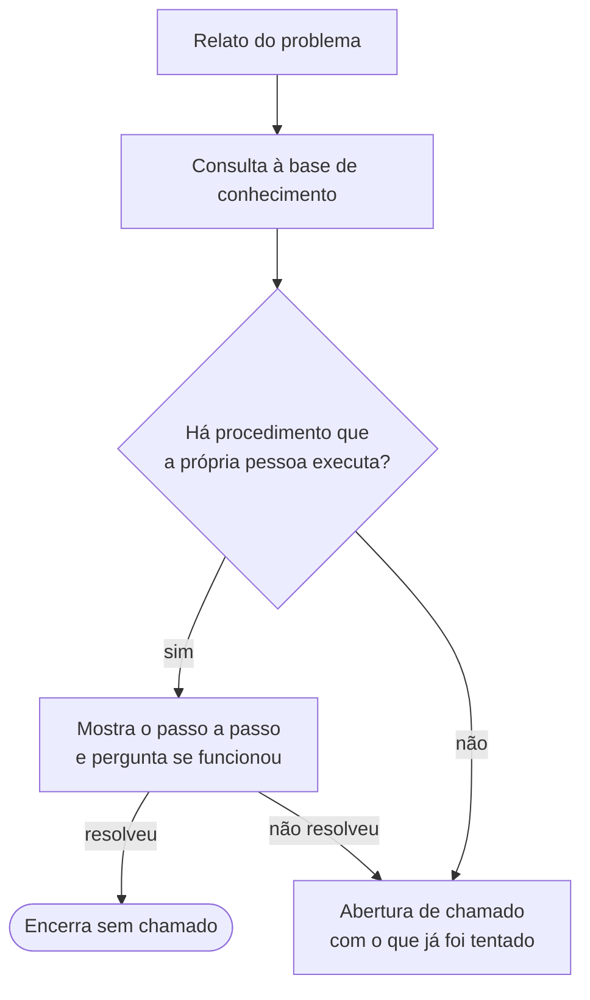

# Fluxos de Atendimento

## Abertura de chamado

| Risco | Controle |
|---|---|
| Abrir chamado em nome de outra pessoa | O solicitante é o e-mail do diretório do Teams, nunca um texto digitado |
| IA inventar categoria ou campos | A IA só escolhe um serviço de uma **lista fechada**. Todos os campos enviados ao Cervello vêm de tabelas validadas |
| Abertura sem intenção | Confirmação **escrita** depois de um resumo do que será aberto. Emoji não confirma |
| Chamado duplicado por clique repetido | Cada fluxo tem um identificador único, invalidado ao criar o chamado |
| Arquivo malicioso anexado | Só PNG/JPG, conferidos pelo conteúdo real do arquivo; até 8 MB e 3 arquivos; nome sanitizado; download só de domínios da Microsoft |

## Consulta de chamados

| Risco | Controle |
|---|---|
| Ver chamado de outra pessoa | O filtro é o e-mail do diretório e é aplicado **pelo próprio Cervello**. Um e-mail digitado é ignorado |
| Descobrir se um chamado existe | "Não existe" e "não é seu" recebem a **mesma resposta** |
| Injeção pelo texto de um chamado | O conteúdo dos chamados nunca é enviado à IA |

!!! success "Verificado em uso real"
    Quatro pessoas na mesma reunião do Teams pediram "meus chamados". Cada uma recebeu apenas os
    próprios chamados.

## Atendimento pela base de conhecimento

!!! danger "Procedimento do Service Desk nunca chega ao colaborador"
    Cada artigo da base declara quem o executa: `usuario`, `analista` ou `misto`. **Só artigos
    `usuario` são mostrados.** Procedimentos de analista, como desbloqueio no AD ou senha
    temporária, poderiam servir de roteiro de engenharia social. Eles vão no máximo como
    referência, dentro do chamado, para o analista. A regra é aplicada por código e coberta por
    teste.

- No máximo 2 perguntas e 2 tentativas antes de propor o chamado.
- Se a base estiver fora do ar, a conversa segue normalmente, sem a base.
