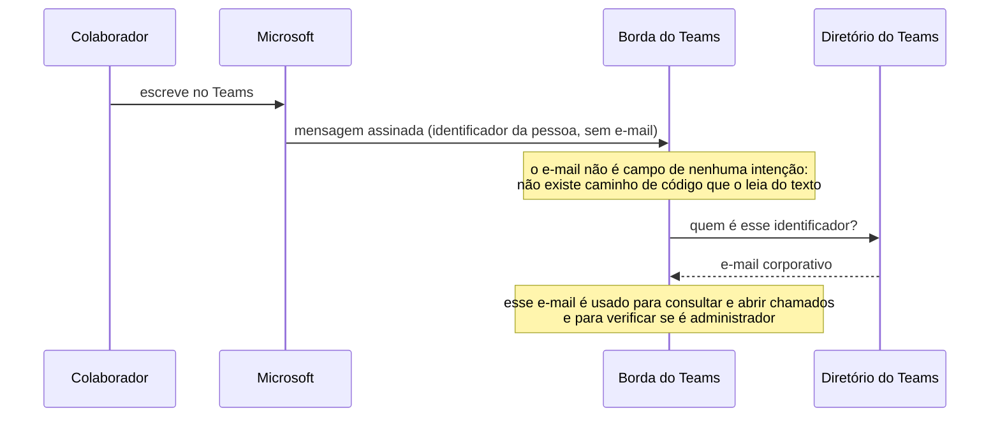
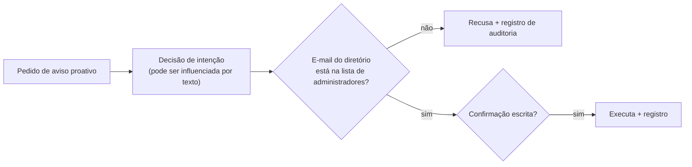

# Identidade e Autorização

## De onde vem a identidade

A mensagem do Teams não traz o e-mail de quem escreveu, só um identificador assinado pela
Microsoft. O sistema busca o e-mail no diretório do próprio Teams, usando a credencial do
assistente.

| Decisão | Por quê |
|---|---|
| E-mail vindo do diretório do Teams, não do texto | Ninguém consegue se passar por outra pessoa digitando um e-mail |
| Vínculo com a **pessoa**, não com o chat | Em grupos e reuniões, várias pessoas compartilham a mesma conversa |
| Identidade não resolvida → recusa | O assistente nunca pergunta o e-mail |
| Sem Microsoft Graph | Não é necessária permissão ampla de diretório nem consentimento de administrador no tenant |

## Quem pode fazer o quê

| Ação | Quem | Controle |
|---|---|---|
| Tirar dúvidas | Qualquer colaborador do tenant | Token da Microsoft válido |
| Consultar chamados | O próprio colaborador | Filtro pelo e-mail do diretório, aplicado no Cervello |
| Abrir chamado | O próprio colaborador, em seu nome | Confirmação escrita após resumo |
| Enviar aviso proativo | **Apenas administradores** | Lista fechada de e-mails, conferida **no momento da execução** |

!!! note "Por que o controle fica na execução"
    Mesmo que alguém convença a IA a "achar" que o pedido é de administrador, a verificação
    acontece depois, no código que executa, com o e-mail do diretório. Com a lista vazia,
    ninguém executa. Quem não é administrador nem vê essas opções no menu.
