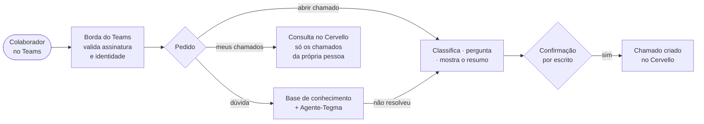

# Agente-Tegma — Documentação de Segurança

**Atendimento de TI da Tegma no Microsoft Teams: fluxos e camadas de segurança.**

Esta documentação foi escrita para a **equipe de segurança da Tegma**. Ela descreve o que o
sistema faz, como uma mensagem percorre os componentes, de onde vem a identidade de quem pede e
quais controles protegem cada etapa. O objetivo é permitir uma avaliação completa da solução.

!!! info "O que esta documentação não contém"
    Credenciais, chaves e valores de segredo não aparecem em nenhuma página. Detalhes internos de
    sistemas de terceiros, como o ITSM Cervello, aparecem apenas como fluxo de funcionamento.

---

## Resumo executivo

| Dimensão | Estado |
|---|---|
| **O que é** | Assistente de TI no Microsoft Teams. Responde dúvidas pela base de conhecimento, abre chamados e consulta chamados no ITSM Cervello |
| **Onde roda** | Google Cloud, projeto `tegma-teams`, região São Paulo (`southamerica-east1`) |
| **Exposição à internet** | Um único serviço público, a borda do Teams. Toda rota exige credencial, exceto o status de saúde, que não revela detalhes |
| **Serviços internos** | Agente de IA e base de procedimentos privados, acessíveis só por contas de serviço autorizadas (IAM) |
| **Identidade** | Vem da mensagem **assinada pela Microsoft**. Nunca é digitada pela pessoa nem inferida pela IA |
| **Papel da IA** | A IA **conversa e escolhe dentro de listas fechadas**. Ações com efeito externo são executadas por código determinístico, com confirmação escrita |
| **Ferramentas da IA** | Apenas leitura da base de procedimentos. Nenhuma ferramenta de escrita, terminal ou acesso a arquivos |
| **Segredos** | Google Secret Manager. Nada no código, em variável em texto ou em log |
| **Dados pessoais** | Telemetria pseudonimizada (HMAC), sem conteúdo. Conversas em base separada, com acesso restrito e retenção de 30 dias |
| **Verificação** | Teste automatizado da superfície de ataque, varredura de dependências e imagens, verificador de postura somente leitura e pentest externo |

---

## O que o sistema faz

---

## Navegação desta documentação

| Seção | Para quem |
|---|---|
| [Escopo do Sistema](escopo.md) | Entender o que o sistema faz e o que não faz |
| [Arquitetura e Topologia](arquitetura.md) | Ver os componentes, a rede e quem fala com quem |
| [Fluxo de uma Mensagem](fluxo-mensagem.md) | Seguir uma mensagem do Teams até a resposta, com cada controle |
| [Fluxos de Atendimento](fluxos-atendimento.md) | Ver a abertura de chamado, a consulta e a base de conhecimento pela ótica da segurança |
| [Identidade e Autorização](identidade.md) | Saber como se garante quem pede e o que cada um pode fazer |
| [Agente de IA e Guardrails](agente-ia.md) | Entender como a IA é contida |
| [Integrações Externas](integracoes.md) | Ver o fluxo com Teams, Cervello, Base de Conhecimento e OpenAI |
| [Superfície de Ataque](superficie-ataque.md) | Saber o que está exposto e o que está fechado |
| [Camadas de Segurança](camadas-seguranca.md) | Ver a defesa em profundidade, na ordem real de execução |
| [Dados, Privacidade e Auditoria](dados-privacidade.md) | Avaliar LGPD, retenção, rastreabilidade e alertas |
| [Operação Segura](operacao.md) | Ver como mudanças entram em produção e como são revertidas |
| [Guia para Avaliadores](guia-avaliadores.md) | Saber o que esperar de cada tipo de teste |
