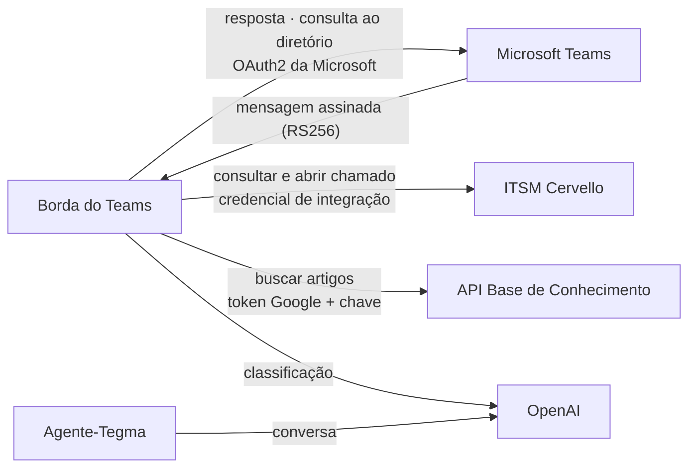

# Integrações Externas

Todas as integrações usam **HTTPS**, e as credenciais ficam no Secret Manager. Nenhum sistema
externo chama a solução, exceto o Microsoft Teams. As demais conexões partem da solução.

## Microsoft Teams

| Direção | Fluxo | Autenticação |
|---|---|---|
| Teams → solução | Cada mensagem chega com um token assinado pela Microsoft | Validação do token na aplicação |
| Solução → Teams | Respostas e consulta do e-mail no diretório da conversa | Credencial do aplicativo no Microsoft Entra ID. Não usa Microsoft Graph |

## ITSM Cervello

| Operação | Fluxo |
|---|---|
| **Consultar chamados** | A solução envia o e-mail do diretório do Teams. O Cervello devolve apenas os chamados desse e-mail |
| **Abrir chamado** | Depois da confirmação escrita, a solução envia o serviço escolhido, a descrição e o e-mail do solicitante. O Cervello devolve o número |
| **Anexar prints** | Depois que o chamado é criado, a solução envia as imagens já validadas ao chamado recém-criado, como anexo restrito |

- A integração usa uma credencial dedicada de integração, guardada no Secret Manager.
- Hoje a integração aponta para o ambiente de **homologação** do Cervello da Tegma.
- A garantia de que cada pessoa vê só os próprios chamados é reverificada com testes de dois usuários a cada mudança no Cervello, como troca de ambiente ou atualização de consulta.

## API da Base de Conhecimento

| Fluxo | Autenticação |
|---|---|
| A solução envia o relato e recebe artigos estruturados, cada um com a indicação de quem o executa | Duas camadas: identidade Google da conta de serviço + chave da aplicação |

Se a API falhar ou demorar mais de 2,5 s, o atendimento segue sem a base, e a pessoa não percebe.

## OpenAI (modelo de linguagem)

| Uso | O que é enviado |
|---|---|
| Classificar o pedido e escolher o serviço do catálogo | Texto da mensagem e lista de opções |
| Conversa do Agente-Tegma | Texto da conversa desde o último assunto encerrado e trechos da base |

**O que não é enviado ao modelo:** e-mail, identificadores do Teams e conteúdo de chamados.

!!! warning "Ponto para avaliação da Tegma"
    O texto digitado pelo colaborador é processado pela OpenAI, fora do Brasil. Esse é um item
    para a avaliação de privacidade (ver [Dados, Privacidade e Auditoria](dados-privacidade.md)).
