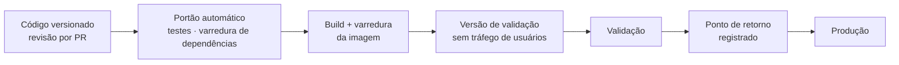

# Operação Segura

## Como uma mudança chega à produção

| Etapa | Garantia |
|---|---|
| **Versionamento** | Toda mudança tem versão numerada e registro do que mudou. A produção corresponde exatamente a uma versão |
| **Portão automático** | Mais de 2.000 testes automatizados e varredura de dependências. Qualquer falha bloqueia o deploy |
| **Imagem** | Construída a partir do código versionado e varrida antes da publicação |
| **Canário** | A nova versão sobe **sem receber usuários**, e é validada antes de assumir o tráfego |
| **Ponto de retorno** | Antes de cada promoção, a versão em uso é registrada a partir da própria produção |

## Reversão

| Situação | Ação | Tempo |
|---|---|---|
| Problema em funcionalidade específica | Funcionalidades novas nascem desligadas e são desligáveis por configuração, sem novo build | Minutos |
| Problema na versão | O tráfego volta para a versão registrada no ponto de retorno | Imediato |

## Gestão de segredos

- Todos os segredos ficam no **Google Secret Manager**. Cada serviço só lê os próprios.
- Um segredo rotacionado passa a valer na próxima versão publicada.
- Toda leitura de segredo fica registrada em log de auditoria.

## Desligamento seguro

Ao reiniciar ou atualizar, o serviço termina as mensagens em andamento antes de encerrar. As
mensagens pendentes na fila são reentregues automaticamente, e cada uma é processada uma única
vez.
